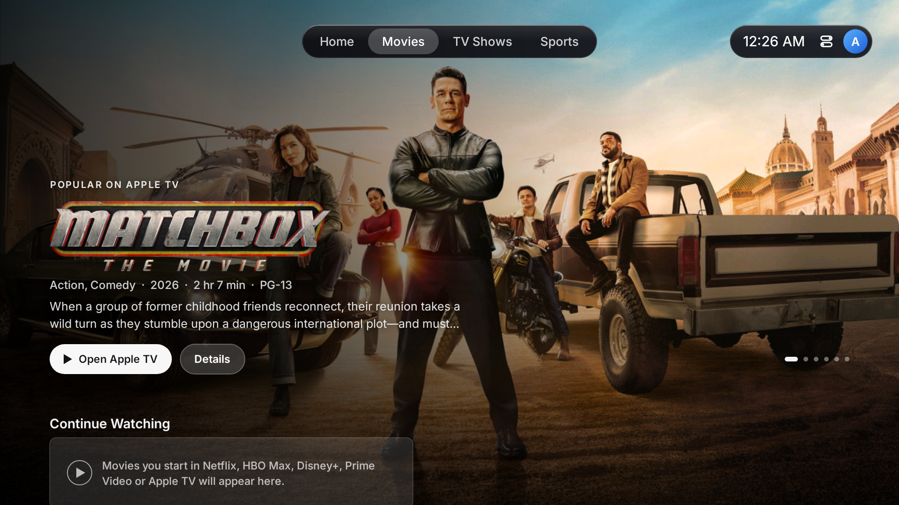

# Glass Home for Fire TV

A tvOS-style home screen for an Amazon Fire TV Stick 4K Plus (Fire OS 8, Android 11), with
no ads and no sponsored rows.



## What it has

- **Home**: a constant background (five included), or a featured title when a streaming app
  is focused, behind a glass dock of 5:3 app tiles six to a row, and the widgets on the right.
  The order: TiviMate, Netflix, Prime Video, HBO Max, Apple TV, Disney+; then FirePlayer,
  YouTube, Spotify, Game Pass, Settings, the Appstore; then Live TV, Downloader, Tailscale.
  Tiles are layered icons: on focus the layers sway a little and settle, a soft light moves
  across them and the edge catches a glare.
- **Movies, TV Shows and Sports** scroll from their banner into shelves, where the banner's
  picture gives way to the Home background, darkened.
- **Tabs** at the top: Home, Movies, TV Shows and Sports. The remote's ☰ (Menu) button jumps to
  them from anywhere; pressing Up repeatedly ends there too.
- **Movies and TV Shows** (TMDB): a hero carousel with title logos, Continue Watching, Top 10,
  new arrivals, "Popular on …" for each streaming app installed, In Theaters and Coming Soon,
  Top Rated. Select opens a details page with where it streams; its "Open …" buttons go
  straight to the title's own page in that app (or to the app, where it has no link for it).
- **Sports** (ESPN): Live Now, My Teams, and a row per league (NFL, college football, NBA,
  NHL, MLB, MLS, Premier League), with live scores, start times and the channel or app.
- **Continue Watching**: built only from what has actually played on this TV, read from the
  streaming apps' media sessions. Fire TV does not share Amazon's or the apps' own watch
  history with other launchers, so it starts empty and fills as you watch. Some apps say that
  they are playing but not what (Netflix): there, a film or show counts once it has been
  opened from Glass Home and plays. FirePlayer tells Android nothing, so it cannot appear.
- **Widgets**: a Smart Stack (one card with weather, your next game, Continue Watching and the
  date) or Glances (four small squares), chosen in Home Screen settings. The stack turns only
  when asked, with Play/Pause while it has focus, and stays where it was left.
- **Control Center** from the status capsule: Sleep, Sleep Timer, Wi-Fi, Bluetooth, and
  shortcuts to screen mirroring, accessibility, display settings and Home Screen settings,
  laid out on the grid of a Figma Community kit of the iOS 26 Control Center.
- **Liquid Glass** after that kit's "Regular" material: the scene behind, lightly frosted and
  bent at the rim, lifted by the kit's plus-lighter tint, with light caught on the top-left and
  bottom-right edges. The focused control turns to the kit's near-white On state. Only the
  kit's measurements and colour recipe are used; its fonts, symbols and images are not.

More screens: [pages](docs/screenshots/sheet-pages.png),
[widgets](docs/screenshots/sheet-widgets.png),
[Control Center and settings](docs/screenshots/sheet-control.png).

## Status

Tested off the device with Robolectric, which renders every screen at 1920x1080 and drives it
with remote key events (navigation, held keys, Back, the Menu button), and installed on a Fire TV
Stick 4K Plus (Fire OS 8.1.8.5): live weather, the Home button redirect, opening the Appstore
and Settings, and both one-time permissions work there. The TV's GPU (PowerVR GE9215) is the
limit on smoothness, so full-screen backgrounds are drawn in one pass, with their scrims and
dimming folded in, and nothing animates behind content that is not on show. Its Home button
service keeps it running as a foreground app, so Android never asks it to free memory: it lets
go of the browse pages' pictures itself while another app is in front. Checked on the TV:
Netflix reports that it is playing and where, but no title; FirePlayer reports nothing. Still
to check: the other streaming apps, and Sleep itself.

## Build and test

Needs JDK 17 and the Android SDK (platform 35) in `ANDROID_HOME`.

```sh
cd launcher
./gradlew assembleDebug        # app/build/outputs/apk/debug/app-debug.apk
./gradlew testDebugUnitTest    # renders into launcher/screenshots/
```

The tests replay TMDB and ESPN responses recorded on 20 October 2026
(`app/src/test/fixtures`), so they run offline and show the same games and titles every time.
To record anything missing: `./gradlew testDebugUnitTest -PnetRecord=true -PtmdbTokenFile=<file>`.

## Install on the TV

With ADB debugging on and the TV reachable at `<tv-address>`:

```sh
adb connect <tv-address>:5555
adb install -r app-debug.apk

# Continue Watching: lets the launcher see what the streaming apps play (Fire TV has no screen for this)
adb shell cmd notification allow_listener app.glasshome.launcher/app.glasshome.launcher.MediaWatcher

# Control Center Sleep and Sleep Timer: allows turning the screen off, nothing else.
# Home Screen settings > Allow Sleep gives it back, so the launcher can always be uninstalled.
adb shell dpm set-active-admin app.glasshome.launcher/.SleepAdmin

# Home button: Fire OS always sends Home to Amazon's home screen, whatever the default home app is.
# This accessibility service notices that screen appearing and brings Glass Home forward
# (long-press Home still opens Fire TV's quick menu). Home Screen settings > Home Button turns it off.
# It is told which app comes to the front and when a remote key is pressed; it takes no keys,
# reads nothing on screen and sends nothing anywhere.
adb shell settings put secure enabled_accessibility_services app.glasshome.launcher/app.glasshome.launcher.HomeButtonService
adb shell settings put secure accessibility_enabled 1

# Home button, the cases Fire OS says nothing about (Home pressed twice quickly, the TV starting):
# lets that service ask which screen is in front, at those moments only.
adb shell cmd appops set app.glasshome.launcher GET_USAGE_STATS allow
```

**TMDB token** (for Movies, TV Shows and featured titles): copy
`launcher/app/src/main/assets/apps.json`, put the token in `tmdb_api_key`, and write it into the
launcher's private files (Fire OS lets ADB into no other folder of the app; this works because it is
a debug build):

```sh
adb shell "run-as app.glasshome.launcher sh -c 'mkdir -p files && cat > files/apps.json && chmod 600 files/apps.json'" < apps.json
```

It stays on the TV; never commit it. The same file sets the app order, hidden apps and
`favorite_teams` (e.g. `"nfl:CIN"`).

## Remote

| Key | Does |
| --- | --- |
| Arrows | Move focus. Held, they step at a steady rate. |
| Select | Opens the focused app, title, game or widget (once per press). |
| ☰ Menu | To the tab bar, closing anything open; again to go back down. |
| Back | Closes what is open, then steps back toward Home. |
| Play/Pause | On the Smart Stack, turns to the next widget (Rewind goes back). |
| Home | Glass Home's Home page, closing anything open, however often it is pressed. Fire OS sends Home to Amazon's home first, so the screen may go dark for a moment on the way (0-0.3 s measured). Held: Fire TV's quick menu. |

## Debloat

`firetv/disabled-packages.txt` lists the 38 packages that were turned off with
`pm disable-user --user 0` (telemetry, ads, recommendations, ambient, shopping, tutorials,
smart-home and Alexa calling services, and unused extras such as miniTV, the games hub, Silk
and Amazon Kids). Nothing was uninstalled, and Fire OS updates, voice, casting and mirroring
were kept. Amazon's own home screen stays installed and enabled (Fire OS sends the Home button
to it, and its Settings menu lives there), but it and its app-tracking client
(`firetv/background-restricted.txt`) may not run in the background:
`cmd appops set <package> RUN_ANY_IN_BACKGROUND ignore`, so its telemetry uploads and row
refreshes wait. `firetv/restore.sh` undoes all of it.

Fire OS's Dynamic Warming keeps the apps Amazon picks as "favorites" (Prime Video and YouTube
here) started in the background so they open faster. It is switched by a system property that
ADB may not change, so it stays on.

Also switched off in Fire TV's own Settings (and switched back on there): Preferences > Privacy
Settings > Device Usage Data, Collect App Usage Data and Interest-based Ads; Preferences >
Featured Content > Allow Video Autoplay and Allow Audio Autoplay (Amazon's home is still opened
by every Home press, for a moment, and no longer starts a preview video when it is).

Fire OS 8.1.8.5 refuses to disable some packages as protected, among them
`com.amazon.device.metrics`, `com.amazon.device.logmanager`, `com.amazon.device.crashmanager`
and `com.amazon.ftvads.deeplinking`.

Private DNS on the TV (for example an ad-blocking resolver) fails while Tailscale runs there:
all traffic goes through Tailscale's VPN, where Android reports Private DNS as broken and no
names resolve. Set the resolver as a nameserver in Tailscale's DNS settings instead.

## Data and credits

- Film and TV data and artwork: [TMDB](https://www.themoviedb.org/). This product uses the TMDB
  API but is not endorsed or certified by TMDB. Streaming availability: JustWatch, via TMDB.
- Links into the streaming apps: JustWatch's public GraphQL API, which is unofficial and may
  change (then "Open …" opens the app itself). Only a title's name is sent: for the banner's titles
  and a details page as they are shown, and for a Continue Watching title when its card is opened.
- Scores and schedules: ESPN's public scoreboard feed, which is unofficial and may change.
- Weather: [Open-Meteo](https://open-meteo.com/).
- Font: [Inter](https://rsms.me/inter/), SIL Open Font License 1.1 (`assets/fonts/Inter-OFL.txt`).
  No Apple fonts, symbols or templates are used.
- App logos are trademarks of their owners, and the backgrounds and several icons were supplied
  for personal use. Keep this repository private.
